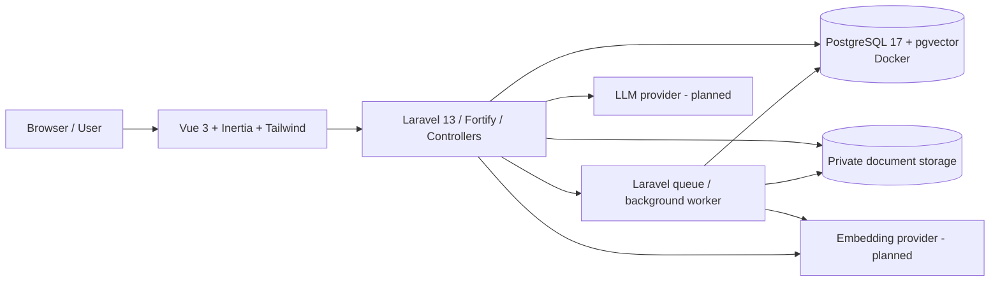
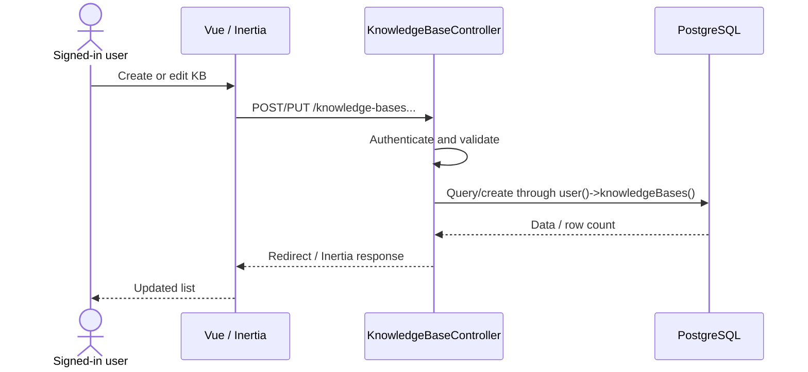
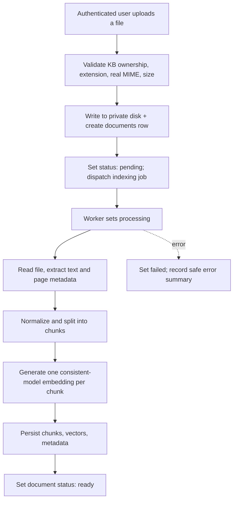
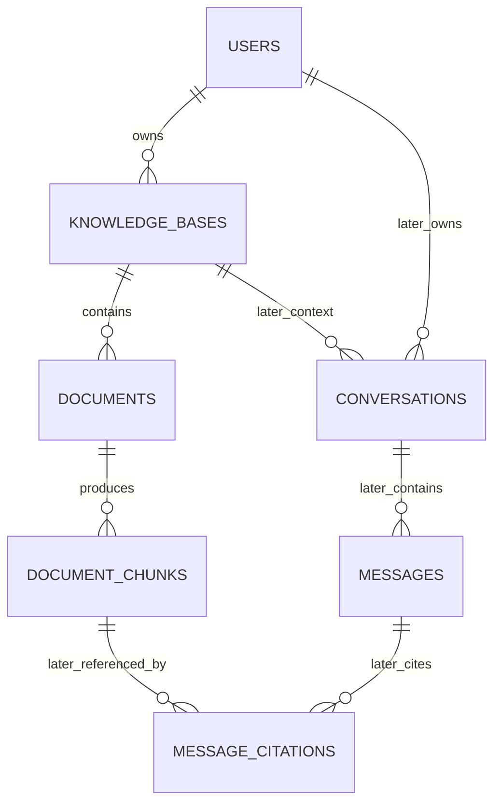

# ContextIQ — Architecture

> **Purpose:** The durable technical reference for building and revisiting ContextIQ, a standalone, single-user-owned (per account) RAG portfolio application. This document separates **implemented/observed** work from **proposed design**. See [`LEARNING_PLAN.md`](./LEARNING_PLAN.md) for the sequence of lessons and verification gates.
>
> **Last reviewed:** 14 November 2026. The original handoff was dated 10 November 2026; subsequent conversation confirmed the page/layout code and a preference for the **Create form on top and Knowledge Bases list underneath**. Sidebar navigation was discussed, but behavior has not yet been independently tested.

## 1. Product vision and MVP boundary

**Goal:** Authenticated users create knowledge bases, upload PDF/TXT/Markdown documents, and ask questions. The assistant retrieves relevant passages from **that user's selected knowledge base**, responds using those passages, and provides traceable document/page citations.

**MVP includes:**
1. Register/login using starter-kit authentication.
2. Create, list, edit, delete user-owned knowledge bases.
3. Upload/list/delete documents securely inside a knowledge base.
4. Queue document extraction, chunking, and embedding; expose processing status.
5. Retrieve relevant chunks with pgvector, constrained to the authenticated user's knowledge base.
6. Generate answers with references; abstain when available evidence is insufficient.

**Later:** conversations/history, streaming, retrieval inspector, evaluation suite, costs/latency reporting, admin operations, production deployment. **Not MVP:** teams, organizations, cross-user sharing, multiple tenants, warehouse-style systems, model training on uploaded documents.

## 2. Status legend

- ✅ **Implemented or observed** in handoff/conversation (not necessarily test-covered).
- 🧪 **Implemented but unverified** end-to-end.
- 🟡 **Planned design** (do **not** assume code/table/service exists).
- ❓ **Decision needed** before implementing that slice.

| Area | Status | Notes |
|---|---|---|
| Linux Mint / Docker / PHP / Node / Composer | ✅ | Local dev environment works |
| Laravel 13 + Vue 3 TypeScript + Inertia + Tailwind | ✅ | Laravel Vue starter kit in `app/` |
| PostgreSQL 17 + pgvector Docker container | ✅ | Database connectivity verified; `vector` migration not yet committed |
| Auth/Fortify | ✅ | Local authenticated user tested |
| `knowledge_bases` table, model, controller, request | ✅ | Ownership-aware lookup used on update/delete |
| Knowledge Base page Create/List/Edit UI | ✅ | UI renders; edit and delete behavior not fully validated |
| Full-width, vertically stacked Knowledge Base UI | 🧪 | Desired layout: create above list; verify actual browser widths |
| Sidebar navigation item for Knowledge Bases | 🧪 | Discussed/added in chat; click/active highlighting not verified |
| CRUD feature tests, validation, isolation | 🟡 | Next engineering gate |
| `documents`, uploads, processing statuses | 🟡 | No implementation reported |
| Queue worker / Redis | 🟡 | Redis is planned, not installed/connected for this project |
| Embeddings, `document_chunks`, vector index | 🟡 | AI SDK/model not installed or chosen |
| RAG retrieval, generation, citations | 🟡 | Not implemented |

## 3. Tech stack and local topology

| Layer | Current decision | Runs where |
|---|---|---|
| Development OS | Linux Mint 22.3 Zena | Host |
| Backend | Laravel 13, PHP 8.3 | Host (`~/projects/contextiq/app`) |
| UI | Vue 3 Composition API, `<script setup lang="ts">`, Inertia, Tailwind | Same Laravel project |
| Auth | Laravel starter kit / Fortify | Laravel |
| Database | PostgreSQL 17 and pgvector (`pgvector/pgvector:0.8.7-pg17`) | Docker `contextiq-postgres` |
| DB host access | `127.0.0.1:5432` | Host to Docker |
| File storage | Laravel **private/local disk** (proposed) | Host; move to object storage later if deploying |
| Queue | Start with Laravel **database queue** if available; Redis later | Host queue worker |
| Embeddings & LLM | Laravel AI SDK proposed; exact providers/models TBD | External or local provider |



**Important:** The frontend is served through the Laravel/Inertia app. PostgreSQL runs in Docker; Laravel itself currently runs on the host, not in Docker. The database is bound to loopback. Never commit `.env` files or credentials.

## 4. The actual request and processing flow

### A. Knowledge Base CRUD — partly implemented



For an existing record, keep the verified ownership pattern:

```php
$knowledgeBase = $request->user()
    ->knowledgeBases()
    ->findOrFail($id);
```

This prevents a signed-in user from retrieving someone else's record via that query. **Tests still need to prove isolation** on GET, update, and delete paths, including nested resources.

### B. Upload and indexing — proposed



Upload should return quickly; extraction/embedding should run in a queue. Prefer **idempotent jobs** and safe retry behavior: the same document/version must not create duplicate chunks or race with deletion. Do not expose raw file paths or provider secrets in responses.

### C. Asking a question — proposed

```mermaid
sequenceDiagram
    actor U as Signed-in user
    participant API as Question controller/service
    participant VS as Retriever (pgvector)
    participant AI as LLM
    U->>API: Ask question within selected KB
    API->>API: Confirm KB belongs to user
    API->>VS: Embed query; search ready chunks filtered to KB
    VS-->>API: Ranked passages + doc/page metadata
    alt No useful evidence
        API-->>U: Cannot answer from uploaded material
    else Evidence found
        API->>AI: Question + cited, bounded source passages
        AI-->>API: Draft grounded answer
        API-->>U: Answer + structured source citations
    end
```

**Security invariant:** Every document, chunk, retrieval query, and citation must resolve to a knowledge base owned by the current authenticated user. Never rely on a client-provided `user_id`.

## 5. Current database vs proposed schema

### Existing, verified schema

`knowledge_bases(id BIGINT PK, user_id BIGINT FK users.id ON DELETE CASCADE, name VARCHAR(255), description TEXT NULL, created_at, updated_at)`.

`User` ↔ `KnowledgeBase` relationship exists. The live database has had a test knowledge base. Do not mistake that for a complete production data model.

### Proposed MVP schema (review field names before creating migrations)



| Table | Proposed columns | Reason |
|---|---|---|
| `documents` | `id`, `knowledge_base_id` FK, `original_name`, `disk`, `path`, `mime_type`, `size_bytes`, `sha256`, `status`, `error_message` NULL, `processed_at` NULL, timestamps | Track secure uploaded file and indexing lifecycle |
| `document_chunks` | `id`, `document_id` FK, `chunk_index`, `content` TEXT, `page_number` NULL, `embedding` VECTOR(N), timestamps | Evidence units with original location and search vector |
| `conversations` (later) | `id`, `user_id`, `knowledge_base_id`, `title`, timestamps | Persistent chat sessions |
| `messages` (later) | `id`, `conversation_id`, `role`, `content`, timestamps | Chat history |
| `message_citations` (later) | `id`, `message_id`, `document_chunk_id`, `reference_label` or snapshot fields | Trace answer back to evidence at answer time |

**Decisions to make when implementing:**
- `documents.status`: `pending`, `processing`, `ready`, `failed` (application-level values; start with validated string rather than altering a DB enum every time).
- `VECTOR(N)`: **N depends on the selected embedding model/dimension**. Do not create an arbitrary-sized vector field before selecting the model. The same embedding configuration must be used for both stored chunks and queries.
- Start with exact similarity queries for correctness at small scale. Add a pgvector HNSW/cosine index if data volume/performance justifies it, and measure recall/latency. Avoid premature index tuning.
- Chunking strategy: prefer splitting with bounded length and overlap while preserving page/section offsets and stable chunk indices. Set actual limits only after testing against representative PDFs.
- Consider checksum/versioning for re-uploads and reindexing. Deleting a document must remove related chunks and private file bytes safely.

Laravel 13's AI SDK documentation describes PostgreSQL vector columns, embeddings and vector similarity query capabilities; however, **the SDK has not yet been added to this project**. See references below.

## 6. Suggested code boundaries (future, not existing files)

Do not create everything at once. Add each file only when a lesson needs it.

```text
contextiq/
├── app/                                     # Existing Laravel application root
│   ├── app/
│   │   ├── Http/
│   │   │   ├── Controllers/
│   │   │   │   ├── KnowledgeBaseController.php   [EXISTS]
│   │   │   │   ├── DocumentController.php        [PLANNED]
│   │   │   │   └── QuestionController.php        [PLANNED]
│   │   │   └── Requests/
│   │   │       ├── KnowledgeRequest.php          [EXISTS]
│   │   │       ├── StoreDocumentRequest.php      [PLANNED]
│   │   │       └── AskQuestionRequest.php        [PLANNED]
│   │   ├── Models/
│   │   │   ├── User.php                          [EXISTS]
│   │   │   ├── KnowledgeBase.php                 [EXISTS]
│   │   │   ├── Document.php                      [PLANNED]
│   │   │   └── DocumentChunk.php                 [PLANNED]
│   │   ├── Jobs/
│   │   │   └── ProcessDocument.php               [PLANNED]
│   │   └── Services/Rag/
│   │       ├── TextExtractor.php                 [PLANNED]
│   │       ├── TextChunker.php                   [PLANNED]
│   │       ├── EmbeddingService.php              [PLANNED]
│   │       ├── Retriever.php                     [PLANNED]
│   │       └── AnswerService.php                 [PLANNED]
│   ├── database/migrations/
│   ├── resources/js/pages/
│   │   ├── knowledge-bases/Index.vue            [EXISTS]
│   │   ├── knowledge-bases/Show.vue             [PLANNED]
│   │   └── chat/Index.vue                       [PLANNED]
│   ├── routes/web.php
│   └── tests/Feature/
├── infra/compose.yaml                       # PostgreSQL [EXISTS]
├── ARCHITECTURE.md                          # Copy this file here
└── LEARNING_PLAN.md                         # Copy companion roadmap here
```

*Place `ARCHITECTURE.md` and `LEARNING_PLAN.md` at the ContextIQ repository root when ready to version them.*

### Responsibility rules

| Layer | Owns | Should not own |
|---|---|---|
| Vue/Inertia page | User input, state, progress display | Real authorization, SQL, AI API secrets |
| Form Request / Policy | Input validation and access decisions | Embedding logic |
| Controller | HTTP orchestration, status/redirects | PDF parsing, giant prompts |
| Model / DB | Data integrity, relations, persistence | Provider HTTP calls |
| Indexing job / services | Extraction, chunking, vectors, retries | Browser UI concerns |
| Retriever | KB-scoped search; provenance metadata | Inventing an answer |
| Answer service | Grounded prompt, citations, fallback | Cross-user data access |

## 7. Authorization and privacy requirements

1. Protect every relevant route with `auth` and validate inputs server-side.
2. Use user-owned knowledge base queries. For nested routes, resolve `knowledgeBase` **from the signed-in user** before fetching `Document` beneath it.
3. Store files on a private disk, not public web storage. Download/preview must stream through an authorized route.
4. Validate file contents/MIME type, not just extension; enforce size/count limits and a safe PDF/TXT/Markdown allowlist.
5. Treat extracted file content as **untrusted data**, never instructions. Use it as a cited source, not as commands to the assistant. Defend against prompt injection in retrieved text.
6. Expose only the minimum source text in answers; don't send other users' chunks to a model provider.
7. Keep `.env`, API keys, raw credentials, and private uploaded files out of Git. Review outbound provider data handling before real uploads.
8. Test cross-user ID guessing, delete vs indexing races, missing files, malformed PDFs, failed AI calls, and duplicate job delivery.
9. Implement quotas/timeouts and safe logging before public release.

## 8. Testing strategy and delivery gates

- **Gate 1 (next):** All four Knowledge Base routes exist; browser CRUD survives refresh; validation errors shown; different users cannot read/update/delete each other's data. Add Laravel feature tests.
- **Gate 2:** Files upload to private storage; invalid/oversized inputs rejected; documents list shows truthful statuses; owner-only downloads/deletion; tests with `Storage::fake()`.
- **Gate 3:** Known PDF/TXT/Markdown fixtures produce stable text/chunks and page metadata. Failure updates status; retry doesn't duplicate chunks.
- **Gate 4:** Same embedding configuration for query and document; retrieval filters by authenticated KB before returning chunks; isolation test passes.
- **Gate 5:** Fixture questions produce grounded answers and real source references; impossible question receives an appropriate fallback; provider calls faked in tests.
- **Gate 6:** Usability, timing/cost and security regression checks; README can reproduce the environment from scratch without exposing secrets.

For database-dependent tests, use a **separate test PostgreSQL database**, not the dev DB. Do not run destructive schema reset commands against `contextiq` accidentally.

## 9. Open decisions / ADR log

| ID | Decision | State | Rationale |
|---|---|---|---|
| ADR-001 | Personal accounts; each KB owned by one user | **Accepted** | Simple, secure MVP; no organization layer |
| ADR-002 | Laravel 13 + Vue/Inertia monolith | **Accepted** | Learn a complete vertical slice without separate SPA/API deployment |
| ADR-003 | PostgreSQL 17 + pgvector | **Accepted** | Data + vector retrieval in one database |
| ADR-004 | Keep Knowledge Base create form above list | **Accepted (UI)** | User preference, no desktop two-column redesign |
| ADR-005 | Database queue first, Redis later | **Proposed** | Small local MVP avoids unnecessary infrastructure |
| ADR-006 | Specific embedding model and dimension | **Open** | Depends on cost, privacy, dimensions and provider access |
| ADR-007 | PDF extraction library and scanned PDF policy | **Open** | Test PDF text extraction first; OCR is optional and later |
| ADR-008 | Retrieval strategy: exact first, HNSW later | **Proposed** | Prioritize correctness and explainability |
| ADR-009 | LLM provider and monthly budget | **Open** | Costs, privacy and testability need comparison |

When a decision changes, add an entry with **date, decision, why, tradeoffs, migration impact**.

## 10. Local developer runbook

```bash
# Terminal A: database
cd ~/projects/contextiq/infra
docker compose ps
docker compose up -d     # only if not running

# Terminal B: Laravel + frontend
cd ~/projects/contextiq/app
composer run dev

# Terminal C: inspections (separate terminal)
cd ~/projects/contextiq/app
php artisan route:list --path=knowledge-bases
php artisan db:show
php artisan migrate:status
```

Open `http://localhost:8000/knowledge-bases` after login. When queue work is introduced, document the chosen `QUEUE_CONNECTION`, migration prerequisites, and start `php artisan queue:work` in a separate terminal. Check Git status **before** committing; never commit project or infra `.env` files.

## 11. Resume point for the next session

**Next smallest verified step:** Complete Knowledge Base CRUD and authorization feature tests. Confirm the page is full width with **form on top, list below**, and test sidebar navigation. Then begin `documents` migration/model and one secure upload slice. Do not install Redis or an AI provider before those gates are satisfied.

**Mentoring contract:** For each lesson give: (1) goal, (2) concept and why, (3) exact file(s)/small code change, (4) verification command/UI test, (5) one short engineering principle. Ask for source files/output only when necessary; do not restart finished setup.

## 12. References and provenance

**Project source:** `ContextIQ_Development_Handoff_2026-11-10.md` supplied by the user, plus the follow-up Vue code and sidebar-layout conversation. The precise future tables/services in this document are **design proposals**, not claims about repository contents.

**External engineering references (checked 2026-11-14):**
- Laravel 13 AI SDK — embeddings, vectors, retrieval, testing: https://laravel.com/framework/docs/13.x/ai-sdk
- Laravel 13 queues — worker basics: https://laravel.com/framework/docs/13.x/queues
- pgvector project documentation — similarity and indexing: https://github.com/pgvector/pgvector

> **Engineering principle:** Architecture is a set of explicit boundaries and testable decisions, not a mandate to create every class before the first user workflow works.
